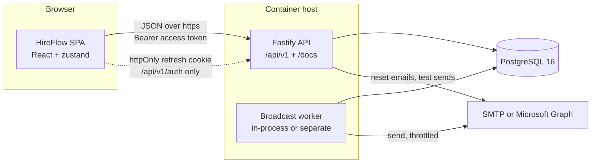
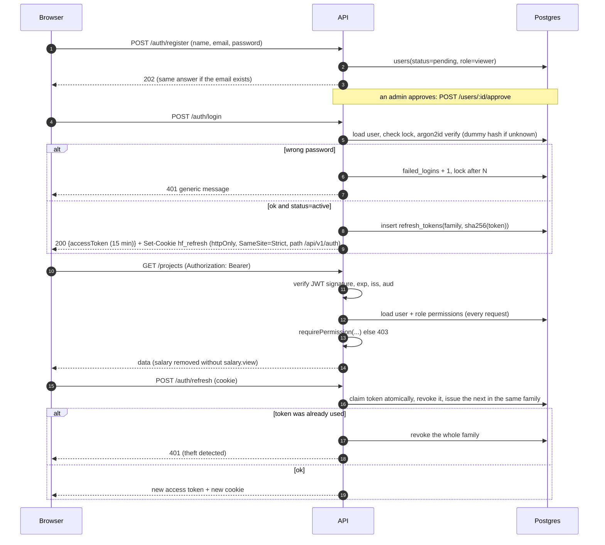
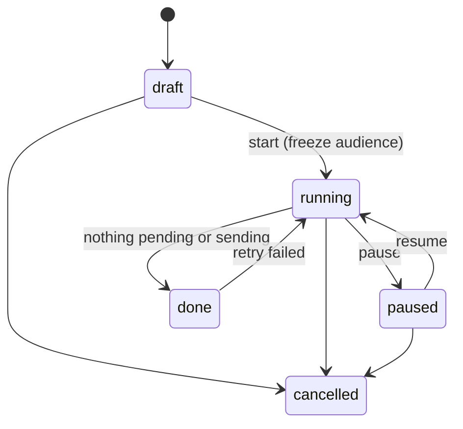

# Architecture

## System overview

- **SPA** (`/src`): static files, today on Vercel, talking to the API with `fetch`.
- **API** (`/server`): one Fastify process. Routes validate with Zod, authorize with RBAC, talk to Postgres with Drizzle.
- **Worker**: a loop that sends broadcast emails from the `broadcast_recipients` table. It can run inside the API
  process (`WORKER_ENABLED=true`, fine for one instance) or as a second process (`node dist/worker.js`).
- **Postgres** is the only stateful part. There is no Redis and no separate queue service on purpose: the queue is a table.

Code layout inside the API: `routes` (HTTP, validation, permission) -> `service/logic` (rules) -> `db` (Drizzle).
`lib` holds pure helpers. See `server/README.md` for the folder map.

## Data model

Ids are UUIDs. Timestamps are `timestamptz` and travel as ISO strings. Money is whole rupiah in `bigint`.
`created_at` and `updated_at` exist on every domain table. Genuinely nested configuration is `jsonb`:
`projects.stages / pm_stages / info`, `candidates.rounds` (interview rounds with reschedule history),
`schedules.template`, `positions.test_files / form_links`.

```mermaid
erDiagram
  roles ||--o{ role_permissions : grants
  roles ||--o{ users : has
  users ||--o{ refresh_tokens : owns
  users ||--o{ password_resets : requests
  users ||--o{ audit_log : acts

  projects ||--o{ positions : has
  positions ||--o{ test_questions : has
  projects ||--o{ candidates : has
  talents ||--o{ candidates : "pool entry (set null)"
  positions ||--o{ candidates : "applied for (set null)"
  projects ||--o{ share_links : exposes

  projects ||--o{ tasks : has
  projects ||--o{ milestones : has
  milestones ||--o{ tasks : groups
  projects ||--o{ risks : has
  projects ||--o{ members : has
  projects ||--o{ budget_items : has
  projects ||--o{ status_updates : has

  projects ||--o{ invoices : bills
  invoices ||--o{ invoice_items : lines
  projects ||--o{ schedules : "receivable"
  schedules ||--o{ schedule_events : "one per occurrence"
  invoices ||--o| schedule_events : "generated for"
  billing_profile ||--|| billing_profile : "single row"

  leads ||--o{ broadcast_recipients : "snapshot"
  broadcasts ||--o{ broadcast_recipients : queue
  broadcasts ||--o{ email_suppressions : "caused by"
  lead_columns }o--o{ leads : "custom fields (jsonb keyed by id)"
  email_templates
  settings
```

Notes on choices:

- **Soft delete / archive** exists where the frontend has it: `projects.status = archived`, `candidates.archived`,
  `positions.status = closed`, `schedules.active`, `share_links.enabled`. Other deletes are hard and audited.
- **Cascade rules**: deleting a project removes everything inside it. Deleting a talent or a position keeps the
  candidates (the link is set to null). Deleting an invoice marks its schedule occurrence `invoice_deleted`, so the
  auto-drafter does not recreate it.
- **Invoice status** stores `draft | sent | paid`. `overdue` is derived (sent and past due), as in the frontend.
- **Invoice numbers** are `INV-YYYY-NNN`, unique, taken from the highest trailing number; a concurrent insert that
  loses the race retries.
- **Passwords** are Argon2id hashes. Share-link passwords too. Refresh and reset tokens are stored as SHA-256 hashes
  (they are 256-bit random, so a fast hash is fine) and never returned.
- **Salary** columns (`salary_min`, `salary_max` on talents, candidates, positions) are nulled in API output unless
  the caller has `salary.view` (see below).

## Auth and RBAC

Details worth knowing:

- Permissions are looked up from the user's role on **every request**, so changing a role, disabling a user or
  editing a role takes effect immediately even though access tokens live 15 minutes.
- Authorization runs in an `onRequest` hook, before body parsing and validation, so a caller without permission
  learns nothing about a route's request shape.
- Lockout: after `LOGIN_MAX_FAILS` wrong passwords an account is locked for `LOGIN_LOCK_MINUTES`; a locked account
  answers like a wrong password. On top of that `@fastify/rate-limit` limits `/auth/*` per IP.
- Pending and disabled accounts are only told so **after** the password was verified.
- `requirePermission(...perms)` requires all listed permissions; `requireAnyPermission(...)` at least one (the way the
  frontend `ROUTE_ACCESS` works). Route helpers: `guard(...)` and `guardAny(...)`.

Permission to area map (identical ids to `src/types.ts`):

| Area | Read | Write |
| --- | --- | --- |
| Projects | `module.hr` or `module.pm` | `projects.manage` (PM settings: `pm.edit` also) |
| Positions | `module.hr` or `module.pm` | `positions.edit`; questions `tests.edit` |
| Talents, candidates | `module.hr` | `candidates.edit`; delete `candidates.delete` |
| Share links | `share.manage` | `share.manage` (+ `salary.view` to publish salary) |
| PM tasks, milestones, risks, team, status updates | `module.pm` | `pm.edit` |
| Budget | `pm.edit` or `pm.invoice` | `pm.edit` |
| Invoices, schedules, billing profile | `pm.invoice` | `pm.invoice` |
| Leads, templates, columns | `module.mkt` | `mkt.edit` |
| Broadcasts, suppressions | `module.mkt` | `mkt.send` |
| Users and roles | `roles.manage` | `roles.manage` |

## Broadcast queue design

Goal: send one campaign to about 4,300 people reliably, politely and without ever double sending.

Recipient rows: `pending -> sending -> sent | failed | skipped | cancelled`.

1. **Start** copies the matching leads into `broadcast_recipients` (one row per lowercased email, unique per broadcast),
   with a snapshot of the merge fields. Leads without a valid address, unsubscribed, suppressed or duplicate are left out
   and counted in the audience preview.
2. **Worker tick** (every `WORKER_POLL_MS`, immediately after start/resume):
   1. rows stuck in `sending` longer than `BROADCAST_STALE_SENDING_SECONDS` become `failed` with a clear message;
   2. if outside the send window (`BROADCAST_WINDOW_*` in `BROADCAST_TZ`) stop;
   3. in **one transaction**: take an advisory lock, count sends in the last 60 seconds and today (local day in
      `BROADCAST_TZ`) plus rows already `sending`, compute `min(perMinute - n, perDay - m)`, select that many due rows
      `FOR UPDATE SKIP LOCKED`, mark them `sending` and increment `attempts`;
   4. for each claimed row: re-check that the broadcast is still running and the address is not suppressed, render the
      message (merge fields, footer, `List-Unsubscribe` headers), call the `MailProvider`;
   5. success -> `sent` with `sent_at` and provider message id; temporary error -> `pending` with
      `next_attempt_at = now + base * 2^(attempt-1)` (capped at 6 h); permanent error or attempts exhausted -> `failed`
      with the error text kept on the row;
   6. running broadcasts with nothing pending or sending become `done`.
3. **Idempotency**: a row can only be claimed once (row lock + status change in the same transaction), settling only
   touches rows still `sending`, and the provider gets the recipient id as an idempotency key (SMTP uses it as the
   `Message-ID`). If the process dies after the provider accepted a message but before `sent` was written, the row stays
   `sending`, is later marked `failed` with "delivery state unknown", and is **never resent automatically**. That is
   at-most-once delivery by design. A human can press "retry failed" after checking.
4. **Pause** stops new claims at once; a message claimed a moment earlier goes back to `pending`. **Cancel** turns all
   `pending` rows into `cancelled`. **Resume** continues where it stopped.
5. **Suppression**: `email_suppressions` is checked when building the audience and again right before each send.
   `POST /api/v1/unsubscribe/:token` (RFC 8058 one-click, token is an HMAC of email + broadcast id) adds the address,
   flags the lead, and drops queued mail for that address in every broadcast. `GET` only shows a confirm button, so
   mail scanners that prefetch links cannot unsubscribe people.

Throughput: at the default 30 per minute and 1,000 per day, 4,300 recipients take about 5 days of sending windows.
Raise the caps only as far as your mail provider and domain reputation allow; new domains should ramp up slowly and
need SPF, DKIM and DMARC set up. `GET /broadcasts/:id` returns progress and rough time remaining.

## Deployment notes

**SPA on Vercel, API in a container.** Any host that runs a Docker image works (Fly.io, Railway, Render, a VM, ECS,
Cloud Run). Use a managed Postgres 16 (Neon, Supabase, RDS, Cloud SQL, Fly Postgres) with `DB_SSL=true`.

**Cookies and domains (decide this first).** The refresh cookie is `SameSite=Strict`. A cross-site fetch does not send
it, so the SPA and the API must be **same-site**. Two options:

1. Put both under one registrable domain, e.g. `app.example.com` (Vercel) and `api.example.com` (container).
   Set `CORS_ORIGINS=https://app.example.com`, `COOKIE_SECURE=true`. This is the simplest.
2. Keep one origin by adding a Vercel rewrite `/api/:path*` -> `https://<api-host>/api/:path*`, and call the API with
   relative URLs. No CORS needed, but all API traffic passes through Vercel.

A `*.vercel.app` SPA calling an API on another domain will **not** keep its login. Use a custom domain.

**Checklist for production**

- `NODE_ENV=production`, `COOKIE_SECURE=true`, real secrets (`openssl rand -base64 48`), `TRUST_PROXY=true` behind a
  load balancer (otherwise every client shares one IP and the rate limits misfire).
- `MAIL_PROVIDER=smtp` (or `graph` once credentials exist); set `MAIL_FROM`, `PUBLIC_API_URL` (unsubscribe links must be
  reachable by recipients), `BROADCAST_FOOTER_ADDRESS`.
- Run `db:migrate:prod` as a release step if you run more than one replica.
- One worker is enough. Several are safe.
- Put `/docs` behind auth or set `DOCS_ENABLED=false` if you do not want it public.

**Backups.** Rely on the managed provider's point-in-time recovery (enable it) and keep daily logical dumps too:
`pg_dump --format=custom "$DATABASE_URL" > hireflow-$(date +%F).dump`, stored off the database host and encrypted.
Test a restore into a scratch database every quarter. Personal data (candidates, salaries, leads) is the sensitive part:
encrypt disks and dumps, restrict who can read the database, and decide a retention period for rejected candidates and
unsubscribed leads.

**Observability.** The API logs JSON with pino (request id on every line, `authorization`, `cookie` and `set-cookie`
redacted). Ship stdout to your platform's log search. Alert on: `/readyz` failing, 5xx rate, `auth.refresh_reuse_detected`
and `auth.account_locked` audit events, broadcast recipients stuck in `failed`, and the worker not sending while due rows
exist. The `audit_log` table records auth events and sensitive mutations with actor, IP and request id. Add an error
tracker (Sentry) and uptime check on `/healthz`; both are one plugin away, neither is wired by default.

## Known limits and decisions left open

- Access tokens cannot be revoked individually; they expire in `ACCESS_TTL_SECONDS` (default 15 minutes). Disabling a
  user is immediate because status is read per request.
- Two tabs refreshing at the same instant race on the refresh token and the loser's family is revoked. The SPA must
  serialize refresh calls (one in flight at a time); see the migration doc.
- Invoice PDFs are still generated in the browser. Moving them server side is a separate piece of work.
- Candidate files (uploaded test PDFs) are not stored by the API yet; only metadata is. Choose S3-compatible storage
  when you add it.
- The Microsoft Graph provider is a stub that needs Entra app credentials and has not run against a live tenant.
